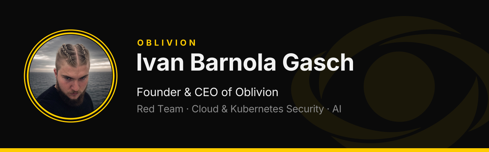
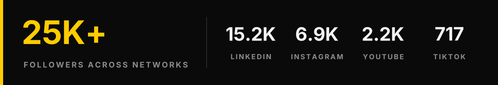
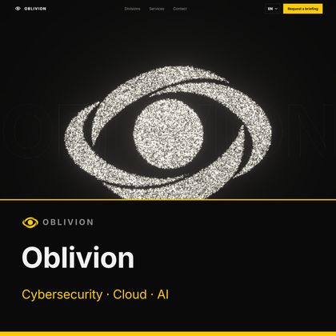
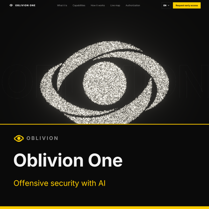
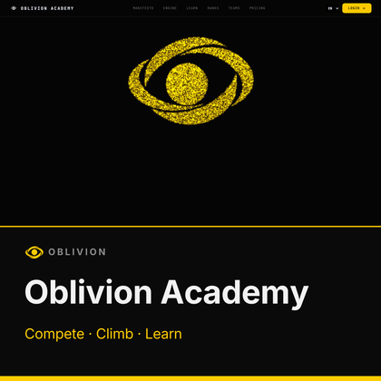
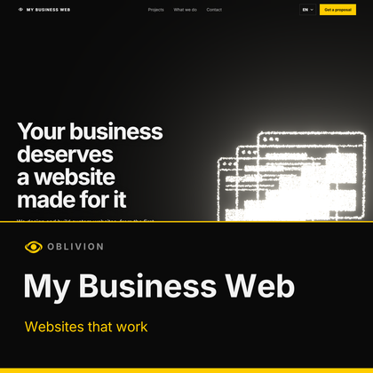
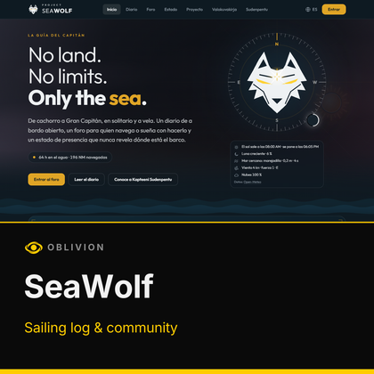
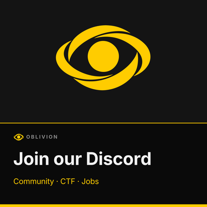

  

  
  
  
  

## About

I started building in 2015 and soon moved into offensive security. In 2026 I founded **Oblivion**, a technology company focused on cybersecurity, cloud infrastructure and artificial intelligence.

- 🔴 **Penetration testing and Red Team** operations
- ☁️ **Cloud and Kubernetes security**, Linux hardening
- 🤖 **Secure AI and LLM** integration and automation
- 🌐 **Websites and web apps**: design, development, hosting and security
- 🧩 **Vulnerability and threat analysis** (CVEs, supply chain attacks)

**Verified:** Hack The Box Endgames **Hades** and **RPG** · Security Blue Team (Penetration Testing, OSINT) · TCM Security Linux 100 · Kubernetes security training.

## Audience

  

  <a href="https://www.linkedin.com/in/ivanbg2004/">LinkedIn</a> ·
  <a href="https://www.instagram.com/ivanbg_2004/">Instagram</a> ·
  <a href="https://www.youtube.com/channel/UCBJhl-WSH4g-df9TGbA4U6Q">YouTube</a> ·
  <a href="https://www.tiktok.com/@ivanbg_2004">TikTok</a> ·
  <a href="https://www.linkedin.com/newsletters/oblivion-dominio-cibern%C3%A9tico-7405361186059489280/">Newsletter</a> (2.3K subscribers)
   Followers across all my networks, not GitHub alone. Source: Favikon, November 2026.

## The Oblivion ecosystem

<table>
  <tr>
    <td align="center" width="33%"></td>
    <td align="center" width="33%"></td>
    <td align="center" width="33%"></td>
  </tr>
  <tr>
    <td align="center"></td>
    <td align="center"></td>
    <td align="center"></td>
  </tr>
</table>

**Allies:** [One AI](https://oneai.ml/) (co-founder, AI and LLM solutions) · [AerionCloud](https://aerioncloud.com/) (co-founder, EU cloud infrastructure)

## Toolkit

  
  
  
  
  
  
  
  
  
  
  
  
  
  

---

  <b>Work with Oblivion</b> → <a href="https://obliviondh.com">obliviondh.com</a> · <b>Join the community</b> → <a href="https://discord.gg/sb5TdP4gqx">discord.gg/sb5TdP4gqx</a>

